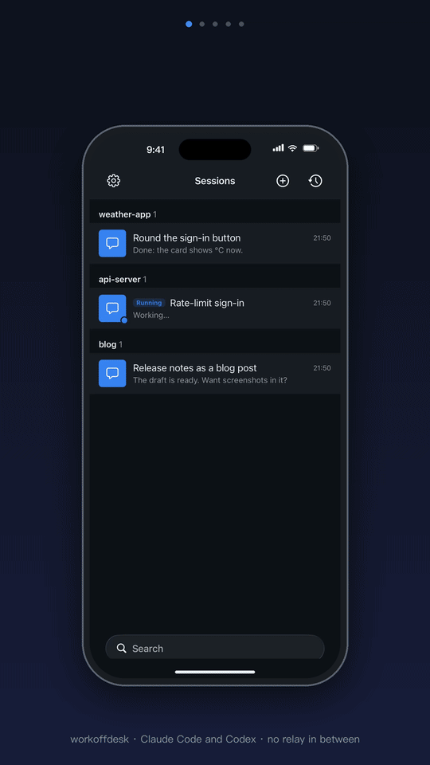
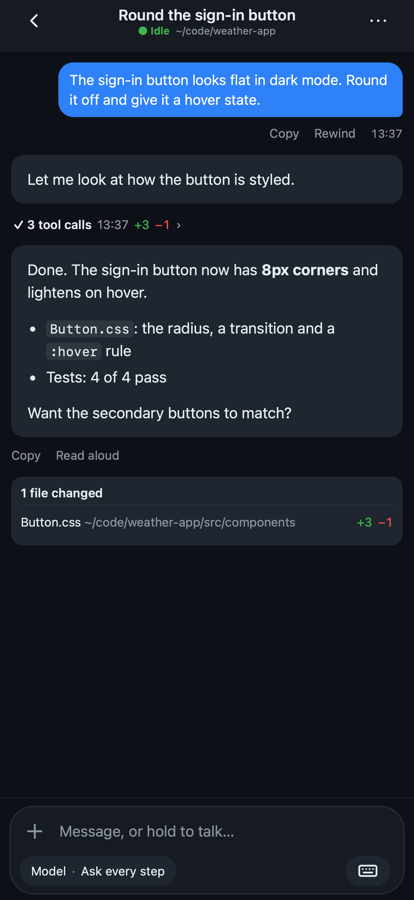
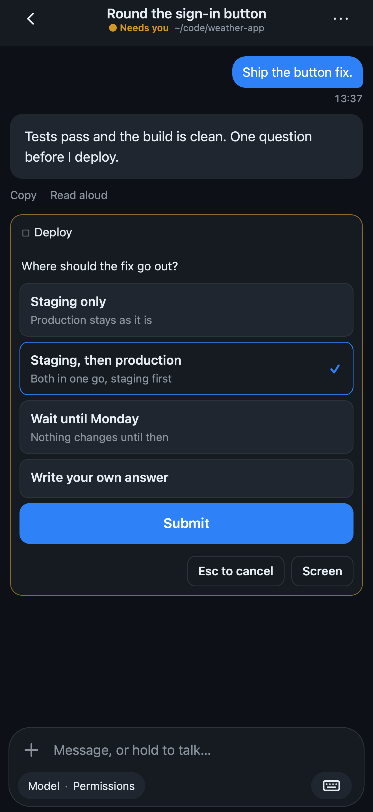
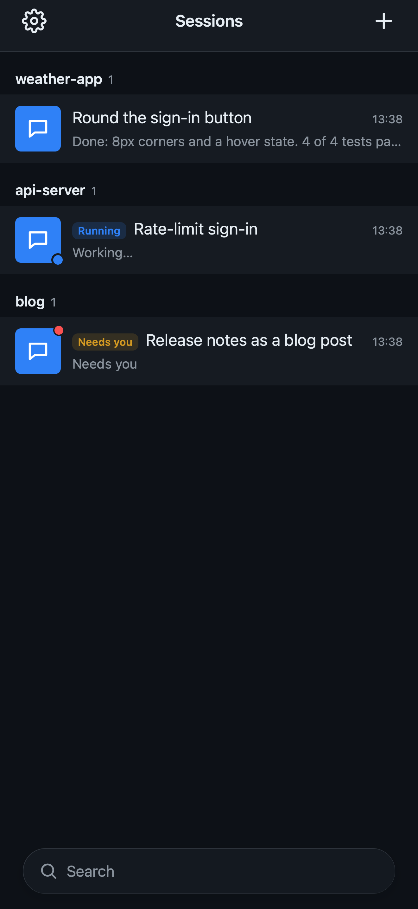

#  workoffdesk

**Chat with the Claude Code and Codex sessions on your Mac from your phone.**

English · [简体中文](README.zh-CN.md)

<p align="center"></p>

## What makes it different

- **No account, nothing in between.** It is a small web app on your own Mac; your phone reaches it over the
  path you choose, such as Tailscale, a Cloudflare Tunnel or your own server. Only an iPhone app someone
  publishes for others has its notifications passed on by the publisher's relay, sealed so it cannot read them.
- **Sessions outlive the phone.** Each one runs in tmux on the Mac: closing the page, locking the phone or
  restarting the service does not end it.
- **Leaving the desk, take it with you; back at it, keep going.** A Claude Code conversation running in a
  terminal on the Mac can be taken over from the phone, and `workoffdesk attach` joins any session from the
  Mac's terminal.
- **Tap instead of typing keys.** Claude's questions, permission prompts and panels like `/usage` become
  cards on the phone.
- **Claude Code or Codex.** Start either in a project folder; each session is named after what its
  conversation is about, so the list says what each one does.

## Screens

<table width="100%">
  <tr><th width="33%">Chat</th><th width="33%">A question from Claude</th><th width="33%">Sessions</th></tr>
  <tr><td width="33%"></td><td width="33%"></td><td width="33%"></td></tr>
</table>

## How it fits together

<p align="center"></p>

```text
phone: the web app, or the iPhone app
   │   HTTPS, over the path you choose: Tailscale, a Cloudflare Tunnel, your own server
   ▼
the workoffdesk service on your Mac   (listens on 127.0.0.1, runs as a launchd agent)
   │
   ▼
tmux sessions: Claude Code or Codex, each in a project folder
```

Everything runs on your Mac, and everything it keeps is in `~/.workoffdesk`. You look after the service from
any of four places; they run the same checks:

| Where | What it is for |
|---|---|
| `workoffdesk` in a terminal | Set up, install, start, stop, check, join a session, upgrade and roll back. See [Commands](#commands). |
| The setup page (`workoffdesk setup --web`) | The first setup, step by step in your browser: the checks, your account, the address, the service, and the address as a QR code. |
| The menu bar app (`apps/mac`, built from source) | Whether the service runs at a glance; failed checks with their fixes, start, stop and restart, the QR code, the Claude account. |
| Settings → **This Mac**, on the phone or the web | The checks, the version, the newest warnings and errors, Restart and Roll back, and which Claude account new sessions run on. |

## Quick start

On the Mac (macOS, with [Claude Code](https://docs.anthropic.com/en/docs/claude-code) installed, and
[Codex](https://github.com/openai/codex) if you use it):

```bash
curl -fsSL https://raw.githubusercontent.com/workoffdesk/workoffdesk/main/install.sh | bash
```

`install.sh` installs tmux and Node with Homebrew if they are missing and never uses `sudo`. Run in a terminal
on a Mac not set up yet, it then opens the setup page in your browser. Without the script, or by hand:

```bash
npm i -g workoffdesk   # needs Node 22.13+ and tmux 3.3+
workoffdesk setup --origin https://workoffdesk.example.com
workoffdesk install    # then run the launchctl line it prints
workoffdesk doctor
```

`setup` asks for a username and a password; `install` writes a launchd service and prints the command that
starts it; `doctor` checks everything and says what to do about anything that fails. See
[Install](docs/guide/install.md).

## Reach it from your phone

The server listens on `127.0.0.1` only. Put HTTPS in front of it: `tailscale serve` keeps the traffic
between your own devices, while a Cloudflare Tunnel works from any network but Cloudflare sees the traffic.
[Remote access](docs/guide/remote-access.md) compares the options and sets each one up.

> [!WARNING]
> Whoever signs in can run any command on your Mac as you. Use a strong password, keep the address to
> yourself, and read [SECURITY.md](SECURITY.md).

## Using it

A typical day: start a task at the desk with `workoffdesk claude`, or in a terminal as usual and take it over
from the phone later. Away from the desk, answer Claude's questions and send the next steps from the phone.
Back at the desk, `workoffdesk attach` joins the same session, with everything the phone did in it.

### On the phone

1. Open your address (`setup` prints it as a QR code) and sign in.
2. Add it to the home screen.
3. In Settings, add a passkey and turn on notifications.

Then:

- **Start or go on.** ⊕ starts Claude or Codex in a project folder, or opens a recent conversation from the
  Mac to read and continue. One still open in a terminal on the Mac can be taken over, now or once its
  current step is done.
- **Read it as a chat.** Claude's replies are rendered as Markdown and tool calls are folded. Questions,
  permission prompts and panels like `/usage` are cards to tap; **Screen** shows the Mac's screen as text
  when the chat cannot show what Claude waits on.
- **Send.** Type, hold to talk, or add pictures, videos and files. What you send while Claude works goes
  into Claude's own queue. **Stop** interrupts it; **Rewind** goes back to an earlier point.
- **Be told.** A notification comes when Claude waits for you or finishes a turn.

Prefer a native app? [Build the iPhone app](docs/guide/ios-app.md) with your own Apple Developer account.
Everything else is in [Usage](docs/guide/usage.md).

### At the Mac

```bash
workoffdesk claude        # start Claude in this folder as a session, and join it
workoffdesk codex         # the same for Codex
workoffdesk attach        # join a session, picked from a list
```

It is the same tmux session the phone shows, so both can be on it at once. `Ctrl-b d` detaches and leaves
it running. In a session on the phone, ⋯ → **Continue on the Mac** shows the `attach` command to copy.

### Looking after the service

`workoffdesk doctor` checks macOS, Node, tmux, Claude Code, Codex, the setup, the service, your address, idle
sleep and the iPhone push key, and prints the fix for each failure. The same checks, with the service's
newest warnings and errors, are on Settings → **This Mac** and in the menu bar app. A new version is installed
with `workoffdesk deploy`, which smoke-tests it before switching and switches back if it does not come up;
`workoffdesk rollback` goes back one release. See [Upgrade](docs/guide/upgrade.md) and
[Troubleshooting](docs/guide/troubleshooting.md).

While the service runs it keeps the Mac from idle sleep; the display still sleeps, and closing the lid still
sleeps the Mac.

## Commands

Each is run as `workoffdesk <command>`.

| Command | What it does |
|---|---|
| `setup` | Asks for a username and a password (12 characters or more) and writes the config. Run again, it sets a new password and signs every device out. |
| `setup --web` | The setup as a page in your browser, including the address and the service. |
| `install` | Writes the launchd agent and `~/.local/bin/workoffdesk`, starts nothing, and prints the commands to run. `--tunnel <name>` also sets up an existing Cloudflare tunnel. |
| `start` | Starts the service and waits up to 30 seconds for it to answer. |
| `stop` | Stops the service until the next login or `start`. |
| `restart` | Restarts the service. Sessions keep running. |
| `doctor` | Runs every check, prints the fix for each failure, and exits 1 while anything fails. |
| `status --json` | The checks, the version, the releases, the address, whether the service runs, and its newest 20 warnings and errors. |
| `activity --json` | How many sessions are working: a line now and one at each change, until the service stops. The menu bar app reads it. |
| `push <title> <body>` | Sends a plain message to every phone and browser registered with the service. Exits 1 when the service is not running. |
| `claude [--resume <session id>]` | Starts Claude in this folder as a session and joins it; with `--resume`, going on with that conversation. |
| `codex [--resume <thread id>]` | The same for Codex. |
| `attach [id]` | Joins a session from this terminal; without an id, lists them to pick one. |
| `serve` | Runs the server in this terminal instead of as the service. |
| `deploy <build folder>` | Installs a build as a new release, smoke-tests it, switches to it and restarts the service; keeps the newest 3. |
| `rollback` | Goes back to the release before. |
| `--version` | Prints the installed version. |
| `--help` | Prints this list, one line for each command; so does `workoffdesk` with no command. |

Everything is kept in `~/.workoffdesk`; set `WORKOFFDESK_HOME` to keep it elsewhere. Settings such as
`pinnedDirs` are in [Configuration](docs/guide/configuration.md).

## Compared with similar tools

Checked on 2026-10-07. These products change quickly; check again before quoting this table.

| | Works with | Traffic goes through | Account needed | After the network drops | Native apps | License |
|---|---|---|---|---|---|---|
| **workoffdesk** | Claude Code, Codex | Your Mac and the path you choose | None | Session keeps running in tmux | iPhone (build it yourself); web app | MIT |
| [Claude Code Remote Control](https://code.claude.com/docs/en/remote-control) | Claude Code | Anthropic API | Claude Pro, Max, Team or Enterprise | Reconnects; the local process must keep running | Claude iOS and Android | Not stated |
| [Happy](https://github.com/slopus/happy) | Claude Code, Codex | Happy Server, end-to-end encrypted | Not stated | Not stated | iOS, Android, macOS, web | MIT |
| [zalify/offdesk](https://github.com/zalify/offdesk) | Anything in tmux | A hub, end-to-end encrypted | None to self-host | Session keeps running in tmux | iOS (TestFlight), Android, desktop | MIT |
| [VibeTunnel](https://github.com/amantus-ai/vibetunnel) | Any terminal program | The tunnel you choose | Not stated | Not stated | macOS; iOS in progress | MIT |

<!--
Sources, read 2026-10-07:
- workoffdesk: docs/facts.md (Codex: Sessions)
- Claude Code Remote Control: https://code.claude.com/docs/en/remote-control
  (traffic through the Anthropic API; Pro/Max/Team/Enterprise plan, API keys not supported;
  "reconnects automatically"; the local process must keep running; Claude iOS and Android apps)
- Happy: https://github.com/slopus/happy ("happy claude", "happy codex"; Happy Server with encrypted sync;
  iOS, Android, macOS, web; MIT)
- zalify/offdesk: https://github.com/zalify/offdesk ("anything that runs in tmux"; hub with end-to-end
  encryption; "Self-hosting needs no vendor account"; tmux keeps sessions alive; releases:
  https://github.com/zalify/offdesk/releases; MIT)
- VibeTunnel: https://github.com/amantus-ai/vibetunnel ("Turn any browser into your Mac terminal";
  Tailscale, ngrok, Cloudflare Quick Tunnel; native macOS app, iOS app in progress; MIT)
-->

## Documentation

- [Install](docs/guide/install.md) · [Remote access](docs/guide/remote-access.md) · [Usage](docs/guide/usage.md)
- [Configuration](docs/guide/configuration.md) · [Upgrade](docs/guide/upgrade.md) ·
  [Troubleshooting](docs/guide/troubleshooting.md)
- [How it works](docs/guide/how-it-works.md) · [iPhone app](docs/guide/ios-app.md)
- [Contributing](CONTRIBUTING.md) · [Changelog](apps/server/CHANGELOG.md) · [Security](SECURITY.md)

## License

MIT, see [LICENSE](LICENSE). Not affiliated with Anthropic. Claude is a trademark of Anthropic.
