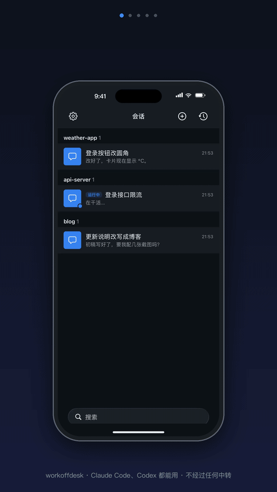
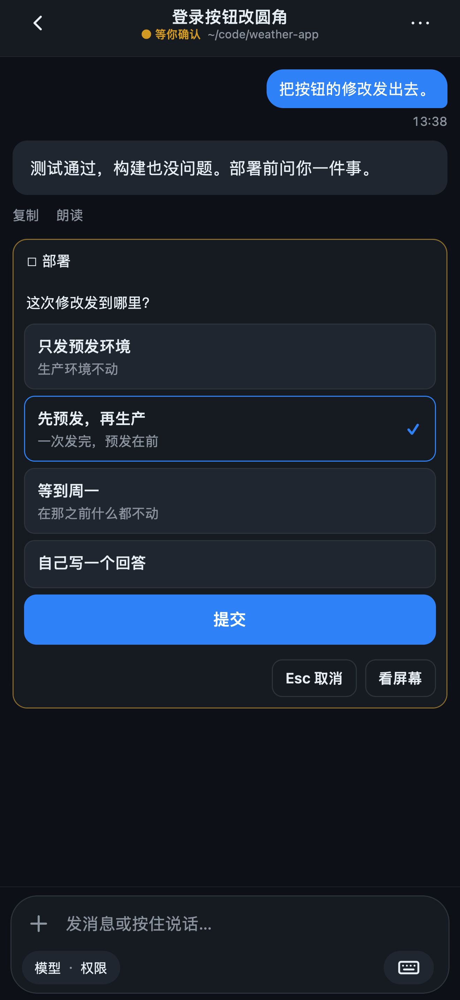

#  workoffdesk

**用手机和你 Mac 上的 Claude Code、Codex 会话聊天。**

[English](README.md) · 简体中文

<p align="center"></p>

## 它有什么不同

- **不要账号，中间也不经过别人。** 它是跑在你自己 Mac 上的一个小网页应用，手机走你自己选的路连过来：
  Tailscale、Cloudflare Tunnel,或者你自己的服务器。只有别人发布给大家用的 iPhone App,通知要经发布者的中转转交，
  内容加了密，中转读不到。
- **手机断了，会话还在。** 每个会话跑在 Mac 的 tmux 里：关掉网页、手机锁屏、重启服务，都不会结束它。
- **离开电脑带着走，回到电脑接着干。** Mac 终端里正在跑的 Claude Code 对话，可以在手机上接管过来;
  `workoffdesk attach` 在 Mac 的终端里接上任何一个会话。
- **点一下，不用按键。** Claude 的提问、权限确认、`/usage` 这类面板，在手机上都变成可以点的卡片。
- **Claude Code 或 Codex。** 在项目目录里开哪个都行;每个会话按对话内容自动起名，列表上一眼看出各在做什么。

## 界面

<table width="100%">
  <tr><th width="33%">聊天</th><th width="33%">Claude 问你问题</th><th width="33%">会话列表</th></tr>
  <tr><td width="33%"></td><td width="33%"></td><td width="33%"></td></tr>
</table>

## 它由哪几块组成

<p align="center"></p>

```text
手机：网页应用，或者 iPhone App
   │   HTTPS,走你自己选的路:Tailscale、Cloudflare Tunnel、你自己的服务器
   ▼
你 Mac 上的 workoffdesk 服务   (只监听 127.0.0.1,作为 launchd 服务运行)
   │
   ▼
tmux 会话：每个会话在一个项目目录里跑 Claude Code 或 Codex
```

一切都跑在你的 Mac 上，存的东西都在 `~/.workoffdesk`。照看这个服务有四个地方，它们跑的是同一套检查:

| 在哪 | 用来做什么 |
|---|---|
| 终端里的 `workoffdesk` | 设置、安装、启动、停止、检查、接上会话、升级和回滚。见[命令](#命令)。 |
| 设置页(`workoffdesk setup --web`) | 第一次设置，在浏览器里一步步来：检查、账号、地址、服务，最后把地址显示成二维码。 |
| 菜单栏 App(`apps/mac`,需从源码编译) | 一眼看出服务在不在跑;没通过的检查和修复方法，启动、停止、重启，二维码,Claude 账号。 |
| 手机或网页上的「设置 → **这台 Mac**」 | 检查结果、版本、最近的警告和错误，重启和回滚，以及新会话用哪个 Claude 账号。 |

## 快速开始

在 Mac 上(macOS,已经装好 [Claude Code](https://docs.anthropic.com/en/docs/claude-code);用
[Codex](https://github.com/openai/codex) 的话也装上它):

```bash
curl -fsSL https://raw.githubusercontent.com/workoffdesk/workoffdesk/main/install.sh | bash
```

`install.sh` 缺 tmux、Node 时用 Homebrew 装上，从不用 `sudo`。在终端里、在还没设置过的 Mac 上运行时，
它接着在浏览器里打开设置页。不用脚本，或者想手动来:

```bash
npm i -g workoffdesk   # 要 Node 22.13+ 和 tmux 3.3+
workoffdesk setup --origin https://workoffdesk.example.com
workoffdesk install    # 然后执行它打印的那行 launchctl
workoffdesk doctor
```

`setup` 设用户名和密码;`install` 写好 launchd 服务，并打印启动它的命令;`doctor` 逐项检查，
哪项不过就告诉你怎么办。详见[安装](docs/guide/install.zh-CN.md)。

## 从手机连过来

服务只监听 `127.0.0.1`,前面要放一个 HTTPS 入口。`tailscale serve` 让流量只在你自己的设备之间走;
Cloudflare Tunnel 在任何网络下都能用，但 Cloudflare 看得到流量内容。
[外网访问](docs/guide/remote-access.zh-CN.md)比较了几种方式，并逐一写了设置步骤。

> [!WARNING]
> 谁登录进来，谁就能以你的身份在这台 Mac 上执行任何命令。密码要够强，地址别外传，并读一下
> [SECURITY.md](SECURITY.md)。

## 怎么用

典型的一天：在电脑前用 `workoffdesk claude` 开始一个任务，或者照常在终端里开，之后再从手机接管。
离开电脑时，在手机上回答 Claude 的提问、发下一步。回到电脑前,`workoffdesk attach` 接上同一个会话，
手机上做过的都在里面。

### 在手机上

1. 打开你的地址(`setup` 会把它打印成二维码),登录。
2. 添加到主屏幕。
3. 在设置里加一个 Passkey,打开通知。

然后:

- **开始或接着做。** ⊕ 在项目目录里开 Claude 或 Codex,或者打开 Mac 上最近的一段对话，先看再接着做。
  还开在 Mac 终端里的对话可以接管过来：马上接，或者等它这一步做完再接。
- **当聊天来看。** Claude 的回复按 Markdown 显示，工具调用折叠起来。提问、权限确认和 `/usage` 这类面板是
  可以点的卡片;聊天里看不出 Claude 在等什么时,**看屏幕**把 Mac 的屏幕以文字显示出来。
- **发消息。** 打字、按住说话，或者加图片、视频和文件。Claude 干活时发的消息直接进 Claude 自己的队列。
  **停止**打断它;**回退**回到之前的某个点。
- **有事通知你。** Claude 等你回复或做完一轮时，会推送通知。

想要原生 App?用你自己的 Apple 开发者账号[编译 iPhone App](docs/guide/ios-app.zh-CN.md)。
其余的都在[使用](docs/guide/usage.zh-CN.md)里。

### 在 Mac 上

```bash
workoffdesk claude        # 在当前目录开一个 Claude 会话，并接上它
workoffdesk codex         # Codex 同理
workoffdesk attach        # 从列表里挑一个会话接上
```

它和手机上看到的是同一个 tmux 会话，两边可以同时在上面。`Ctrl-b d` 断开，会话继续跑。
在手机上的会话里,⋯ →「**在电脑上继续**」会给出可以复制的 `attach` 命令。

### 照看服务

`workoffdesk doctor` 检查 macOS、Node、tmux、Claude Code、Codex、设置、服务、你的地址、空闲睡眠和 iPhone
推送密钥，每项没过都给出修复方法。同样的检查，连同服务最近的警告和错误，也在「设置 → **这台 Mac**」和
菜单栏 App 里。新版本用 `workoffdesk deploy` 装，它先冒烟测试再切换，起不来就切回去;
`workoffdesk rollback` 回到上一个版本。见[升级](docs/guide/upgrade.zh-CN.md)和
[排查问题](docs/guide/troubleshooting.zh-CN.md)。

服务运行时会阻止 Mac 空闲睡眠;屏幕照样会灭，合上盖子 Mac 照样会睡。

## 命令

每条都写成 `workoffdesk <命令>` 来跑。

| 命令 | 做什么 |
|---|---|
| `setup` | 设用户名和密码(至少 12 个字符),写好配置。再跑一次会设新密码，并让所有设备退出登录。 |
| `setup --web` | 在浏览器里做设置，包括地址和服务。 |
| `install` | 写好 launchd 服务和 `~/.local/bin/workoffdesk`,不启动任何东西，打印接下来要跑的命令。加 `--tunnel <名字>` 还会设好一个已有的 Cloudflare tunnel。 |
| `start` | 启动服务，最多等 30 秒等它应答。 |
| `stop` | 停掉服务，直到下次登录或 `start`。 |
| `restart` | 重启服务。会话继续跑。 |
| `doctor` | 跑全部检查，每项没过都给出修复方法;有任何一项没过就以 1 退出。 |
| `status --json` | 检查结果、版本、保留的各个版本、地址、服务在不在跑，以及最近 20 条警告和错误。 |
| `activity --json` | 几个会话正在干活：现在输出一行，之后每次变化再输出一行，直到服务停下。菜单栏 App 读的就是它。 |
| `push <标题> <正文>` | 给登记在服务上的每部手机和浏览器发一条普通消息。服务没在跑就以 1 退出。 |
| `claude [--resume <session id>]` | 在当前目录开一个 Claude 会话并接上;加 `--resume` 就接着那段对话。 |
| `codex [--resume <thread id>]` | Codex 同理。 |
| `attach [id]` | 在当前终端接上一个会话;不给 id 就列出来让你挑。 |
| `serve` | 在当前终端里跑服务器，而不是作为后台服务。 |
| `deploy <build 目录>` | 把一个构建装成新版本，冒烟测试、切过去并重启服务;保留最新 3 个。 |
| `rollback` | 回到上一个版本。 |
| `--version` | 打印装的版本。 |
| `--help` | 打印这张命令表，每条命令一行说明；不带命令直接运行 `workoffdesk` 也一样。 |

存的东西都在 `~/.workoffdesk`;设 `WORKOFFDESK_HOME` 可以换个地方。`pinnedDirs` 这类设置见
[配置](docs/guide/configuration.zh-CN.md)。

## 和同类工具比较

2026-10-07 核对。这些产品变化很快，引用前请再核一次。

| | 支持什么 | 流量经过谁 | 要不要账号 | 断网之后 | 原生 App | 授权协议 |
|---|---|---|---|---|---|---|
| **workoffdesk** | Claude Code、Codex | 你的 Mac 和你选的那条路 | 不要 | 会话在 tmux 里继续跑 | iPhone(自己编译);网页应用 | MIT |
| [Claude Code Remote Control](https://code.claude.com/docs/en/remote-control) | Claude Code | Anthropic API | Claude Pro、Max、Team 或 Enterprise | 自动重连；本机进程得一直开着 | Claude iOS、Android | 未说明 |
| [Happy](https://github.com/slopus/happy) | Claude Code、Codex | Happy Server,端到端加密 | 未说明 | 未说明 | iOS、Android、macOS、网页 | MIT |
| [zalify/offdesk](https://github.com/zalify/offdesk) | tmux 里的任何程序 | 一个中转 hub,端到端加密 | 自己部署不要 | 会话在 tmux 里继续跑 | iOS(TestFlight)、Android、桌面 | MIT |
| [VibeTunnel](https://github.com/amantus-ai/vibetunnel) | 任何终端程序 | 你选的隧道 | 未说明 | 未说明 | macOS;iOS 在做 | MIT |

<!-- 来源见 README.md 里同一张表下面的注释,2026-10-07 读。 -->

## 更多文档

- [安装](docs/guide/install.zh-CN.md) · [外网访问](docs/guide/remote-access.zh-CN.md) · [使用](docs/guide/usage.zh-CN.md)
- [配置](docs/guide/configuration.zh-CN.md) · [升级](docs/guide/upgrade.zh-CN.md) ·
  [排障](docs/guide/troubleshooting.zh-CN.md)
- [工作原理](docs/guide/how-it-works.zh-CN.md) · [iPhone App](docs/guide/ios-app.zh-CN.md)
- [参与贡献](CONTRIBUTING.md) · [更新记录](apps/server/CHANGELOG.md) · [安全](SECURITY.md)

## 授权协议

MIT,见 [LICENSE](LICENSE)。与 Anthropic 无关。Claude 是 Anthropic 的商标。
